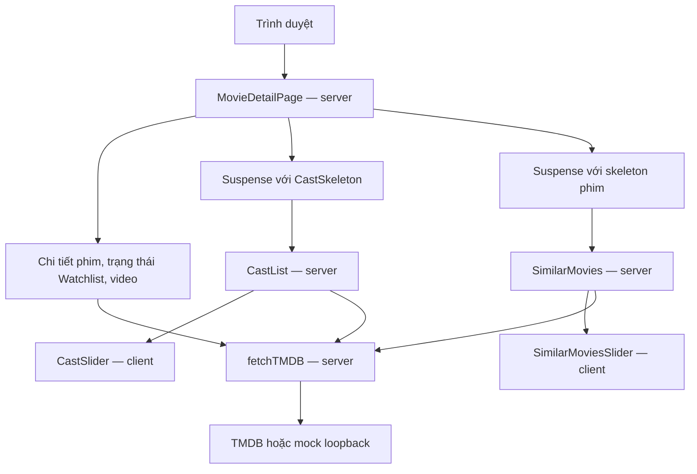

# Đáp án — Streaming và Data Cache

Đọc sau khi làm ba bài trong [hướng dẫn](README.md). Các kết quả mẫu chỉ dùng đối chiếu; người học nộp kết quả của lần chạy riêng.

## Bài 1 — Luồng và boundary



Trang cần chi tiết phim, trạng thái Watchlist và video để dựng phần chính. Cast/similar có thể hoàn tất sau dưới hai Suspense. Các slider, nút Watchlist và modal xử lý tương tác phía client; việc fetch TMDB nằm phía server.

API key được đọc trong `services/client.ts`, không đưa vào `NEXT_PUBLIC_`, props hay mã trình duyệt. Với lab, khóa `evidence-only` là giả. `HttpOnly` của cookie Watchlist không liên quan tới việc giữ khóa TMDB trên server.

Starter chờ cả credits/similar trong `Promise.all` **trước khi trả JSX**. Hai Suspense bên dưới chưa được render nên không thể giúp nội dung chính đến sớm. `loading.tsx` cấp route có thể xuất hiện, nhưng không chứng minh thông tin phim chính đã đến.

## Bài 2 — Bản sửa tối thiểu

Trong `app/movie/[id]/page.tsx`:

```diff
-import { getMovieDetails, getMovieVideos, selectBestTrailer, TMDBError, getMovieCredits, getSimilarMovies } from "@/services/tmdb";
+import { getMovieDetails, getMovieVideos, selectBestTrailer, TMDBError } from "@/services/tmdb";
@@
   const [isSaved, videos] = await Promise.all([
     isMovieSaved(movie.id),
     getMovieVideos(movie.id.toString()),
-    // Lab starter: dữ liệu phụ bị chờ trước khi render các ranh giới Suspense.
-    getMovieCredits(id),
-    getSimilarMovies(id),
   ]);
```

Đây là diff giải thích; thực hiện sửa trong editor. Có thể giữ comment mà vẫn đúng hành vi. Không thêm fetch trình duyệt, xóa skeleton hay thay Server/Client boundary.

`Promise.all` khởi động các tác vụ song song, nhưng `await` vẫn chờ tác vụ chậm nhất. Sau sửa, `CastList` và `SimilarMovies` tự fetch trong các Suspense riêng; phần chính/fallback được gửi trước kết quả phụ.

Verifier yêu cầu năm marker HTML thật, phần chính/fallback ở chunk trước kết quả và khoảng cách từ `main` tới mỗi kết quả phụ ít nhất 1.000 ms trong điều kiện mock. Một response đã buffer vẫn có thể bị chia thành nhiều chunk transport cùng lúc, nên chỉ đếm chunk là chưa đủ. Những mốc này đo lúc HTTP client nhận HTML, không đo lúc trình duyệt vẽ hoặc hydration.

Starter đúng bài khi lint/test/build/typecheck/route đạt rồi thất bại ở assertion streaming. Lỗi build hay kết nối không được tính. Solution đúng khi lượt mới có `verification=lab`, `status=passed`, exit code 0.

Diff bài nộp phải so với snapshot `work/page.starter.txt`. So với HEAD có thể trống vì source sản phẩm vốn đã chứa lời giải. Với `git diff --no-index`, exit code 1 là có khác biệt, không phải nghiệm thu lab thất bại.

## Bài 3 — Counter, dữ liệu và phạm vi cache

Kỳ vọng cho từng endpoint `/movie/<id>` và các suffix `/videos`, `/credits`, `/similar`:

| Mốc | Counter | Nội dung |
| --- | ---: | --- |
| `before`, ID mới | 0 | Chưa tải |
| `miss`, cold request đã đọc hết | 1 | Phiên bản 1 |
| `hit`, trong TTL | 1 | Phiên bản 1 |
| `after_expiry`, đã kích hoạt refresh | 2 | Request kích hoạt có thể còn nhận bản cũ |
| `warm_after_refresh`, refresh hoàn tất | 2 | Phiên bản 2 |

**1. Sau TTL:** request đầu có thể nhận dữ liệu stale và kích hoạt revalidation nền. Hết TTL không tự sinh request khi không có người truy cập. Không được khẳng định request kích hoạt bắt buộc trả Phiên bản 2.

**2. Counter và hoàn tất:** mock tăng counter tại `START`, khi request tới. Counter tăng chưa chứng minh response đã xong. Bộ kiểm chứng đợi refresh rồi xác nhận HTML chứa Phiên bản 2; có thể đối chiếu `END` trong log mock. Warm hit sau đó không làm counter tăng tiếp.

**3. Ba loại ghi nhớ:** Data Cache lưu response giữa các request tới Next; request memoization chỉ có phạm vi một lượt render; cache trình duyệt nằm phía người dùng. Bộ đo dùng HTTP client Node với request mới, không dựa vào cache trình duyệt. Helper truyền `AbortSignal.timeout(10000)`, opt out cơ chế memoization fetch mặc định; không quy số request ở đây cho memoization. `generateMetadata` và page cùng gọi helper cũng không tự chứng minh origin nhận hai request; counter mới là bằng chứng.

**4. Mô hình route:** trang đọc cookie Watchlist nên có dữ liệu theo request, trong khi các fetch TMDB dùng `next: { revalidate }` vẫn có Data Cache. Mô tả là **SSR kết hợp Data Cache**, không suy ISR toàn trang chỉ từ `next.revalidate`. Lab giữ `cacheComponents: false`.

Counter là số request origin, không phải thời gian phản hồi. Mock nhỏ trên máy cục bộ không chứng minh hiệu năng TMDB thật, Core Web Vitals hoặc cache CDN.

## Kiểm tra đóng gói dành cho nhóm biên soạn

Trên source bàn giao chưa có chỉnh sửa riêng của học viên:

```sh
node --test labs/streaming-cache/check-starter.test.mjs
```

Kiểm tra áp dụng/đảo ngược patch trên bản sao rồi so khớp từng byte. Đây là kiểm tra đóng gói, không nằm trong `npm test` hay điều kiện chấm lời giải. Học viên chạy `npm run lab` để kiểm tra hành vi.

`npm run evidence` vẫn là quy trình toàn sản phẩm, gồm Watchlist và Chrome. `npm run lab` dùng chế độ `--lab`, giữ các kiểm tra nền và HTTP streaming/cache, không cần Chrome. Giữ các thư mục kết quả mặc định dưới `evidence/runs/` để không ghi đè lượt trước.

## Nguồn lỗi và minh chứng lịch sử

Hai lỗi kiểm tra patch quá chặt và diff trống đã được tái hiện khi rà bản lab trước. Starter chặn streaming là bài tập cố ý, không được đưa vào AI Disclosure như một lỗi AI thực tế. Các tình huống xử lý khác trong hướng dẫn chưa mặc định là sự cố nhóm từng gặp.

Các thư mục `evidence/starter/`, `evidence/solution/` và tệp install/manual/patch cũ giữ nguyên để truy lịch sử ngày 07/11/2026; chúng thuộc bản lab 75 phút và fingerprint trước lần viết lại. Không ghép chúng với bộ nghiệm thu mới bên dưới.

## Minh chứng bản viết lại

Các lượt dưới đây chạy thật ngày 07/11/2026 trên Linux. Node `v26.12.1`, Next `16.4.5`; Git HEAD `7e06a9a732b9ab5e14c7f9e357d0984291e234be`, working tree có thay đổi chưa commit. Fingerprint canonical của mã runtime/test/config là `8a76a4540cc2ddf4e4d2450d86d9610841651afde68bce76ca4082dd17b18422`; không dùng riêng HEAD để đại diện các thay đổi chưa commit.

| Lượt | Run ID | Kết quả và phạm vi |
| --- | --- | --- |
| [Starter](evidence/rebuilt-starter/mock-runtime.json) | `2026-11-07T09:12:44.078Z` | Exit code 1; lint, 43 test, build/typecheck và route đạt; thất bại đúng tại streaming |
| [Solution giữ comment](evidence/rebuilt-comment-solution/mock-runtime.json) | `2026-11-07T09:13:25.173Z` | Exit code 0; lab đạt với đường dẫn Chrome cố ý không tồn tại |
| [Solution canonical](evidence/rebuilt-solution/mock-runtime.json) | `2026-11-07T09:11:50.194Z` | Exit code 0; lab đạt, không chạy Watchlist/Chrome |
| [Hồi quy toàn sản phẩm](evidence/rebuilt-full/mock-runtime.json) | `2026-11-07T09:13:45.024Z` | Exit code 0; gồm Watchlist và 16 kiểm tra Chrome, lưu ngoài minh chứng báo cáo |

Starter, solution giữ comment và solution canonical có fingerprint khác nhau vì mã trang khác nhau; đọc từng metadata. Hai lượt canonical lab/full có cùng fingerprint nhưng khác `run_id` và phạm vi, không cộng kết quả thành một lượt.

Bộ `npm test` hiện có **43 ca**; kiểm tra đóng gói patch có **1 ca chạy riêng**, không nằm trong bộ lab. Con số 44 của bản cũ được giữ trong log lịch sử.

[Kiểm tra luồng làm bài](evidence/rebuilt-checks/checks.json) ghi cài `npm ci` trong checkout mới, áp dụng starter/snapshot, chấp nhận lời giải giữ comment, diff có nội dung và patch roundtrip. Log cài dependency nằm trong [install-output.txt](evidence/rebuilt-checks/install-output.txt); diff thực tế nằm trong [solution-diff.txt](evidence/rebuilt-checks/solution-diff.txt).

### Số liệu của một lượt canonical lab

Bảng dưới chỉ trích từ [streaming-mock.json](evidence/rebuilt-solution/streaming-mock.json), không ghép thời điểm của lượt khác:

| Marker | Nhận sau (ms) | Chunk |
| --- | ---: | ---: |
| `main` | 58 | 22 |
| `cast_fallback` | 59 | 23 |
| `similar_fallback` | 59 | 23 |
| `cast_result` | 2564 | 29 |
| `similar_result` | 4073 | 55 |

[Data Cache cùng lượt](evidence/rebuilt-solution/cache-mock.json):

| Endpoint | Before | Miss | Hit | Sau refresh | Hit mới |
| --- | ---: | ---: | ---: | ---: | ---: |
| `/movie/1794042737842` | 0 | 1 | 1 | 2 | 2 |
| `/movie/1794042737842/videos` | 0 | 1 | 1 | 2 | 2 |
| `/movie/1794042737842/credits` | 0 | 1 | 1 | 2 | 2 |
| `/movie/1794042737842/similar` | 0 | 1 | 1 | 2 | 2 |

Nội dung được kiểm tra đổi từ **Phiên bản 1** sang **Phiên bản 2**.

### Giới hạn kiểm tra

Đã chạy luồng tự động trên Linux và kiểm tra snapshot/diff tương đương các lệnh hướng dẫn. Checkout mới cài dependency mất 7.927 giây; lệnh starter mất 41.097 giây, lệnh solution giữ comment mất 55.298 giây. Đây là thời gian lệnh tự động, **không phải** thời gian một nhóm sinh viên tự học. Mốc 40 phút là dự kiến phân bổ bài, chưa được xác nhận bằng buổi học với nhóm khác.

Máy kiểm chứng chưa có PowerShell nên chưa chạy trực tiếp các lệnh trên PowerShell; không công bố đã kiểm chứng Windows. Chưa xác nhận một lượt CI GitHub. Không dùng số liệu mock để kết luận Core Web Vitals hay hiệu năng TMDB thật.
